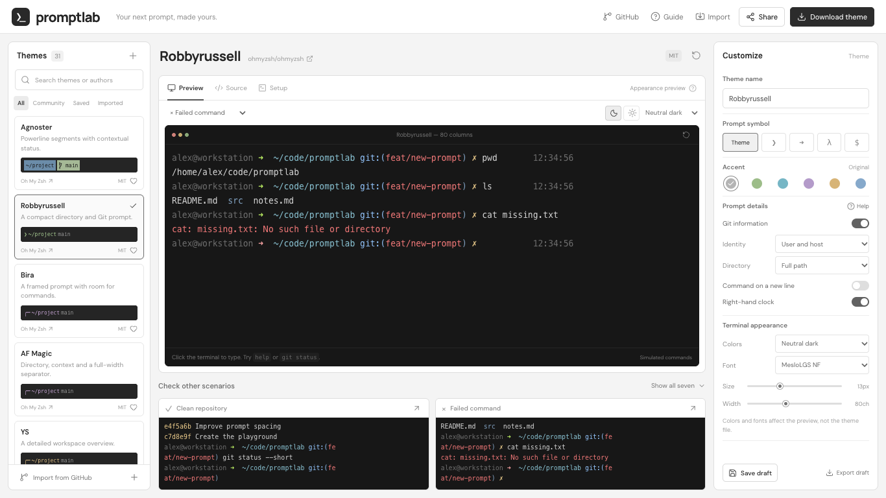
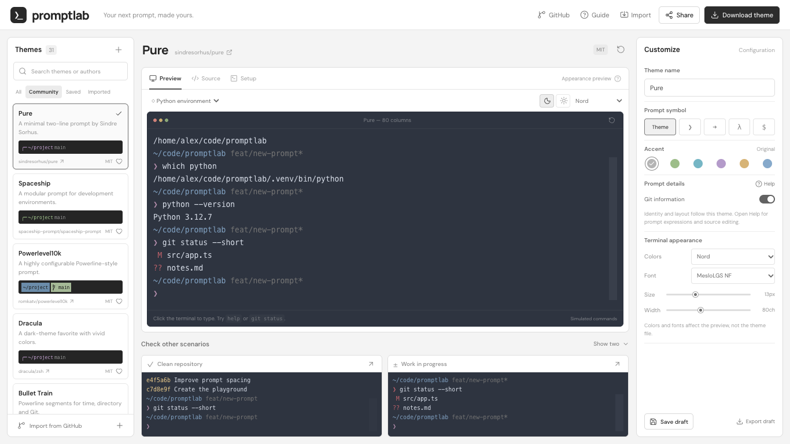
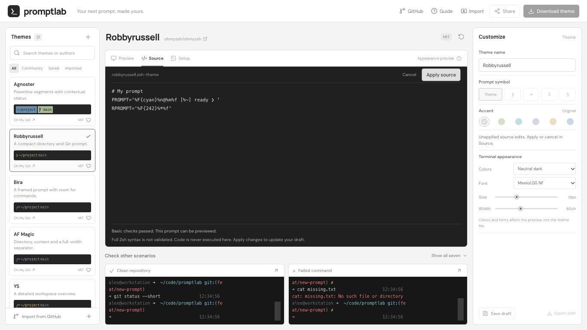

# Promptlab — static Zsh theme playground

[Try Promptlab online](https://guangyya.github.io/promptlab/) · [Browse the source](https://github.com/guangyya/promptlab)

Choose a Zsh theme, explore realistic terminal scenarios, customize its prompt, and download or share the result.

The default app is **100% static**. The production artifact contains HTML, JavaScript, CSS, fonts and licenses. It needs no hosting backend, WebSocket, database, Functions, Workers or VPS. GitHub imports read public GitHub endpoints directly from the browser. Deploy it on GitHub Pages or Cloudflare Pages.

## In the playground

**Customize a familiar theme without writing Zsh.** Add the user and host to Robbyrussell, change the directory format, show a clock, and inspect command failures.



**Compare themes and scenarios.** Browse the community library, switch terminal colors, and try a Python environment alongside clean and failed-command scenarios.



**Edit the source when you need more control.** Basic checks flag unfinished literal prompt quotes; supported expressions can be previewed after applying the changes.



## Run

Requires Node.js 22.12+ or a newer compatible version. Python, Git and Zsh are **not required** for the static app or build.

```sh
git clone https://github.com/guangyya/promptlab.git
cd promptlab
npm ci
npm run dev
```

Open <http://127.0.0.1:4317>. To inspect the actual static artifact:

```sh
npm run check
npm test
npm run build
npm run preview
```

Stop the server already using port 4317 first. `vite preview` is for local inspection; production hosting serves `dist/` directly.

## Features

- 31 presets: 18 Oh My Zsh themes, 12 community themes, and a configurable Studio builder. Source links, pinned revisions and license notices are included.
- Per-theme browser adapters for seven scenarios: clean, dirty, failure, long paths, venv, SSH and conflict. Main previews include several commands with directory listings, output, errors and environment details; comparison cards use shorter transcripts.
- Accent, Git visibility, prompt symbols and editable names. Robbyrussell, Simple, Cloud and Awesomepanda also offer identity, directory, command-line layout and clock controls; Studio has its own layout and identity controls.
- Terminal fonts, palettes, sizes and column counts, displayed through xterm.js.
- An interactive command **simulator** retaining directory and exit status. Type directly in the terminal, edit with arrow keys, recall history, and continue after invalid commands.
- Browser-generated `.zsh-theme` downloads containing the upstream source, supported modifications, provenance and upstream license notice.
- Online source editing with basic checks, a prompt-expression guide, setup instructions, favorites, local drafts and JSON import/export.
- Share links carrying the draft in the URL fragment. They preserve `/repository/` paths and restore on opening or fragment changes. No upload or storage service is involved.
- Self-hosted fonts, relative asset paths, mobile layout and a GitHub Pages workflow. A neutral app background and compact desktop layout fit 1366×768 and 1280×720 screens; theme and scenario lists scroll independently.

## Community library

| Theme | Source | License | Installation |
| --- | --- | --- | --- |
| Pure | [sindresorhus/pure](https://github.com/sindresorhus/pure) | MIT | Upstream engine |
| Spaceship | [spaceship-prompt/spaceship-prompt](https://github.com/spaceship-prompt/spaceship-prompt) | MIT | Upstream engine |
| Powerlevel10k | [romkatv/powerlevel10k](https://github.com/romkatv/powerlevel10k) | MIT | Upstream engine |
| Dracula | [dracula/zsh](https://github.com/dracula/zsh) | MIT | Upstream engine |
| Bullet Train | [caiogondim/bullet-train.zsh](https://github.com/caiogondim/bullet-train.zsh) | MIT | Included in download |
| Typewritten | [reobin/typewritten](https://github.com/reobin/typewritten) | MIT | Upstream engine; Pure layout preset |
| Geometry | [geometry-zsh/geometry](https://github.com/geometry-zsh/geometry) | ISC | Upstream engine |
| Alien | [eendroroy/alien](https://github.com/eendroroy/alien) | MIT | Upstream engine with submodules |
| Powerlevel9k | [Powerlevel9k/powerlevel9k](https://github.com/Powerlevel9k/powerlevel9k) | MIT | Upstream engine; archived classic |
| Agkozak | [agkozak/agkozak-zsh-prompt](https://github.com/agkozak/agkozak-zsh-prompt) | MIT | Upstream engine |
| Git Prompt | [woefe/git-prompt.zsh](https://github.com/woefe/git-prompt.zsh) | MIT | Included in download; default-style preset |
| Lambda Mod | [halfo/lambda-mod-zsh-theme](https://github.com/halfo/lambda-mod-zsh-theme) | MIT | Included in download |

Each entry supports the seven scenarios, prompt symbol, accent, Git visibility, renamed exports and sharing. Engine-based themes export configuration wrappers; Setup provides the matching pinned installation commands. Some presets select a documented layout or subset of modules to make their options predictable. They do not cover every upstream configuration. Terminal palettes and fonts remain preview-only.

## Preview accuracy

The static edition **does not execute Zsh or Git**. Browser adapters approximate each supported theme's appearance and state. They do not prove exact local behavior of arbitrary theme code, ZLE, asynchronous hooks, right prompts, character widths or platform-specific features. The UI labels previews “Appearance preview,” with a guide explaining their limits.

Exports contain actual upstream Zsh code with the selected supported modifications. The preview adapter and source generator are separate implementations; final rendering fidelity still needs confirmation in a real terminal.

GitHub import accepts public repository URLs and direct theme file links. The browser discovers theme files, retrieves source and available license text, and previews supported literal prompt expressions without executing code. Function-built or unsupported imported prompts remain available as source and downloads with an explicit unavailable-preview notice. GitHub rate limits are handled with common raw-file fallbacks; private repositories and unusual branch/file layouts may require a direct file URL. Draft JSON import/export is also available. Arbitrary Shell execution is not provided. Fonts and terminal palettes affect preview only, not `.zsh-theme` exports. Downloads require Oh My Zsh and sometimes a Nerd Font.

A future WebAssembly-based Zsh/Linux runtime could improve fidelity while retaining static hosting; it is not included.

## Source editing and guided options

For Robbyrussell, Simple, Cloud and Awesomepanda, use **Prompt details → Identity → User and host** to add the current shell user and hostname. Directory format, a separate command line and a right-hand clock are also available. These are Promptlab adaptations of the bundled templates, rather than universal upstream configuration variables. **Help** explains common Zsh expressions and can start a simple editable prompt.

Open **Source → Edit source**, change the code and choose **Apply source**. The editor checks for empty or oversized source, binary escape characters and unfinished literal prompt quotes. It does **not** validate full Zsh syntax or execute the source. Simple supported expressions receive an approximate preview; unsupported functions or engine-based source display an explicit unavailable-preview message.

Applied edits are the source of truth for downloads, saved drafts, JSON exports and share links. Prompt controls pause while source edits are pending or active, so they cannot silently overwrite your code. **Cancel** discards pending changes; **Use controls** restores generated source from the retained control settings. Changing themes starts a fresh configuration. Terminal palettes and fonts remain adjustable.

To check downloaded syntax locally, use `zsh -n your-theme.zsh-theme`. Runtime behavior still depends on the selected theme's engine, plugins and terminal.

## Cloudflare Pages

**Quick upload:** run `npm run build`, create a Pages Direct Upload project in the Cloudflare dashboard, and upload `dist/`. No runtime code or secrets are required.

**Git integration:** put the project in its own repository, connect it to Cloudflare Pages and configure:

| Setting | Value |
| --- | --- |
| Root directory | Project root |
| Build command | `npm run build` |
| Build output directory | `dist` |
| Node version | 22.12+; for example `NODE_VERSION=22` |

Do not set `VITE_PREVIEW_ENGINE=native`. Choose Git integration initially if automatic deployments are desired; Direct Upload projects cannot later switch without creating a new project.

To attach your domain, use the project's **Custom domains** settings and follow the DNS instructions. No server IP is needed. Subdomains can use a CNAME to the project's `*.pages.dev` hostname after dashboard association; apex domains have additional Cloudflare DNS requirements.

References: [React on Pages](https://developers.cloudflare.com/pages/framework-guides/deploy-a-react-site/), [Direct Upload](https://developers.cloudflare.com/pages/get-started/direct-upload/), [Custom domains](https://developers.cloudflare.com/pages/configuration/custom-domains/).

## GitHub Pages

1. Put the source in a standalone repository with default branch `main`. Include `src/lib/theme-data.json`, which bundles the upstream theme sources. Do not commit `node_modules/`, local artifacts or the nested `vendor/ohmyzsh` checkout.
2. In **Settings → Pages → Build and deployment**, choose **GitHub Actions**.
3. Push the included `.github/workflows/pages.yml`. It installs dependencies, tests, builds, uploads `dist/` and deploys. Adjust the branch filter if your default branch differs.
4. Open the deployment URL shown in Actions or Pages settings.
5. Optionally add your custom domain in Pages settings and configure the DNS records GitHub provides.

`base: './'` makes assets relative. This single-entry app uses fragment-based sharing, so it works under `https://USER.github.io/REPO/` and at a custom-domain root. No route rewrites are needed; use trailing slashes for directory URLs.

References: [Vite static deployment](https://vite.dev/guide/static-deploy.html), [GitHub Pages workflows](https://docs.github.com/en/pages/getting-started-with-github-pages/using-custom-workflows-with-github-pages).

## Verification

`npm test` checks 217 theme/scenario combinations, 372 accent/Git/export combinations, 124 explicit symbol combinations, Unicode sharing and imported-source roundtrips, custom names, input bounds, recoverable command errors, GitHub discovery/import/rate-limit fallbacks, realistic transcripts, guided options and edited-source validation/export/share roundtrips.

`scripts/browser-check.mjs` checks direct terminal input and error recovery, visible symbols, custom filenames, light/dark palettes, laptop fit, English-only user copy, community source/requirements, GitHub imports, sharing, drafts, mobile layout, **zero hosting backend requests and zero WebSockets**. GitHub API/raw requests are expected only when importing. Run against plain static hosting, not Vite development mode (which uses hot-reload WebSockets). It uses Playwright with installed Chrome; set `PLAYWRIGHT_MODULE` if Playwright is available elsewhere. Set `BASE_URL` to test a repository subdirectory. Screenshots go under `artifacts/`.

`scripts/editor-check.mjs` exercises rich transcripts, the repository link, accent alignment, guided options, exact edited-source downloads, quote-error recovery, preview fallback, persistence, sharing and compact laptop layouts. Run it with the same Playwright setup. Set `CAPTURE_DOCS=1` against the local static preview to refresh the three README screenshots in `docs/images/`.

## Optional original native prototype

`npm run dev:native` retains the earlier local PTY experiment for the original OMZ presets; the expanded catalog and GitHub import are supported by the default static edition. It requires Python 3, Git, `/bin/zsh` and the project-local `vendor/ohmyzsh` snapshot. This is not needed by the static build and is excluded from `dist/`. To restore its development snapshot, run `git clone https://github.com/ohmyzsh/ohmyzsh.git vendor/ohmyzsh` and `git -C vendor/ohmyzsh checkout 17a2b4c3a5855524ad4772a17ada0dc474e2fdf3`.

The native server is a loopback-only trusted-theme demo, not a public execution sandbox. It uses temporary homes/repositories without altering your `.zshrc`. Do not expose it publicly.

## Sources and licenses

Oh My Zsh: <https://github.com/ohmyzsh/ohmyzsh>, pinned to `17a2b4c3a5855524ad4772a17ada0dc474e2fdf3`. OMZ sources and license are bundled in `src/lib/theme-data.json`; community source metadata, pinned revisions and licenses are in `src/lib/community-data.json`. Themes using an upstream engine include pinned install instructions in Setup, including recursive submodule initialization where needed. The Oh My Zsh MIT notice is in `public/licenses/oh-my-zsh.txt`. Community notices are in the same directory and accompany exports. Promptlab code uses the root MIT license; bundled third-party assets retain their own licenses.

MesloLGS NF: <https://github.com/romkatv/powerlevel10k-media>. Its Apache notice and license are in `public/fonts/`. Font/UI dependency notices are in `public/licenses/third-party.txt`. Dependency versions are pinned in `package-lock.json`.
